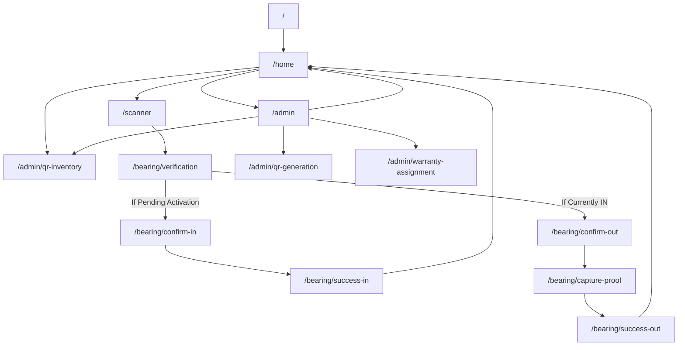

# Route Map — Pivot Bearings India

## 1. Route Hierarchy

---

## 2. Route Registry & Parameter Contracts

| Route Identifier (`AppRoutes`) | Path | Screen Widget | Accepted Arguments | Return / Next Route |
|---|---|---|---|---|
| `AppRoutes.initial` `AppRoutes.customerHome` | `/` `/home` | `CustomerHomeScreen` | None | Primary mobile entry point. Can transition to `/scanner`, `/admin`, or `/admin/qr-inventory`. |
| `AppRoutes.qrScanner` | `/scanner` | `QrScannerScreen` | None | Optical camera viewfinder. On successful decode, navigates to `/bearing/verification` with `bearingId`. |
| `AppRoutes.bearingVerification` | `/bearing/verification` | `BearingVerificationScreen` | `String bearingId` (e.g. `'PB-9402-XJ'`) | Evaluates current lifecycle state. Directs to `/bearing/confirm-in` if not activated, or `/bearing/confirm-out` if installed. |
| `AppRoutes.inConfirmation` | `/bearing/confirm-in` | `InConfirmationScreen` | `String bearingId` | Authoritative timestamp confirmation and camera verification. Navigates to `/bearing/success-in`. |
| `AppRoutes.inSuccess` | `/bearing/success-in` | `InSuccessScreen` | `String bearingId` | Displays active warranty confirmation and telemetry archive. CTA returns to `/home`. |
| `AppRoutes.outConfirmation` | `/bearing/confirm-out` | `OutConfirmationScreen` | `String bearingId` | Removal confirmation warning. Navigates to `/bearing/capture-proof`. |
| `AppRoutes.outVerificationCapture`| `/bearing/capture-proof` | `OutVerificationCaptureScreen` | `String bearingId` | Optical camera proof capture. Runs `ImageCompressionService` and transitions to `/bearing/success-out`. |
| `AppRoutes.outResult` | `/bearing/success-out` | `OutResultScreen` | `String bearingId` | Operational cycle duration calculated. CTA returns to `/home` or `/admin/qr-inventory`. |
| `AppRoutes.adminDashboard` | `/admin` | `AdminDashboardScreen` | None | Responsive telemetry control panel with sidebar navigation. |
| `AppRoutes.qrBulkGeneration` | `/admin/qr-generation` | `QrBulkGenerationScreen` | None | Bulk sequential serial generation and real-time QR matrix preview. |
| `AppRoutes.warrantyAssignment` | `/admin/warranty-assignment` | `WarrantyAssignmentScreen` | None | Bulk warranty assignment and duration configuration. |
| `AppRoutes.qrInventory` | `/admin/qr-inventory` | `QrInventoryScreen` | None | Filterable inventory data grid with direct inspection linkage to `/bearing/verification`. |

---

## 3. Navigation Guard & Fallback Policy
All unrecognized routes fall back via `AppRouter.onGenerateRoute` to a dedicated error page maintaining the strict 2-color styling without application crashing.
